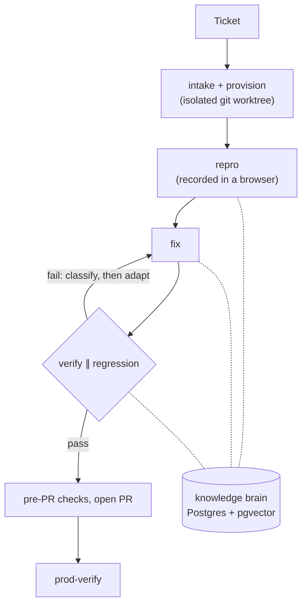

# agent-kit

> Autonomous AI "engineers" for your application, built as self-improving **loops** — not
> one-shot prompts. Stack-agnostic: point it at your repo, your issue tracker, your VCS host.

This repository is a framework for a family of autonomous agents that do real engineering
work on a target application: triaging and reproducing bugs, fixing defects through to a
reviewed pull request (and, once the safety gates are proven, to production), exploring and
learning new features, reviewing pull requests on a schedule, and acting as standing
engineering **personas**. Each agent is a *loop* — a composable recipe of atomic skills
wrapped in deterministic gates, a shared knowledge brain, and safety rails.

The reference loop is **the defect loop** (issue-tracker ticket → verified fix → pull
request → prod confirmation, autonomously). Everything else is modeled on it.

Every external system — tickets, PRs, test management, credentials, CI, analytics, sandboxes —
is reached through an **adapter role** declared once in `.claude/loops/stack.config.json`.
The skills name the role, never a vendor. A Rails + GitHub + Linear shop and a Spring + GitLab +
self-hosted-tracker shop run the same skills with a different config file.

## At a glance

| | |
|---|---|
| **What it is** | Autonomous Claude Code agents that take a ticket to a reviewed pull request, with a deterministic gate between every step |
| **Skills** | 28 atomic skills and loop recipes: intake, repro, fix, verify, regression, code review, ship, prod-verify, explore, dream |
| **Integrations** | 10 vendor-neutral adapter roles (issue tracker, VCS host, CI/CD, sandbox, evidence store and more), picked in one config file |
| **Memory** | A shared Postgres + pgvector knowledge brain, so selectors, flaky-test history and fix patterns carry over to the next run |
| **Safety** | Dry-run and staging-only by default, blast-radius limits, budget caps, a global kill switch flipped only by a human |
| **Developer tooling** | 7 Claude Code mods: one-command ship, dev-server panes, cost meter, secret catcher, cross-session push locks, PR status, brain recall |
| **Tests** | 28 shell test suites, including contract validation and a leak test that keeps the kit free of any company's data |
| **Built with** | Python, Bash, TypeScript (mods), Postgres + pgvector, Playwright, Claude Code |



<sub>The defect loop. Every arrow is a gate with a written contract; a failure is classified before the next attempt, so retries change something.</sub>

## Two ways to use it

- **On your own machine, for your own projects:** the kit plus a personal **overlay** (your config) and a brain database on your machine.
- **In a new codebase (a job or a client):** the same kit plus that client's overlay and their shared, hosted brain, under that job's Claude account.

[docs/setups.md](docs/setups.md) explains the difference in depth, how to connect a fresh project, and what each setup needs. The kit holds no person's or company's data; `.claude/loops/tests/test_no_leaks.sh` keeps it that way.

The kit also ships Claude Code **mods** (status lines, panes, deploy and push guards, CI and review threads): see [mods/README.md](mods/README.md).

---

## The governing idea — loop engineering

This whole system is an application of **loop engineering**:

> **Self-improvement is loop evolution, not model evolution.** The model that fixes a bug
> never changes. What improves is the *system around it* — triage, reproduction, routing,
> and the shared knowledge it accumulates. A weak loop fixes *this* bug. A strong loop
> makes the *next* bug easier to triage, reproduce, and route.

Three principles are load-bearing in every agent built here:

1. **Build the evaluator first.** Each skill declares its success criteria and failure
   categories before anything else. (For the defect loop, the two-video repro/replay *is*
   the test case.)
2. **Improve the workflow, not just the response.** Every run writes reusable knowledge
   back to a shared brain, so the *next* task is easier. Selectors and lessons are learned
   once and propagate.
3. **Classify the failure before adapting.** Retries aren't improvement if they repeat the
   same action. The failure *class* decides what changes on the next attempt.

These principles are derived in full — with the five building blocks, signal sources, the
common failure modes, and a **loop-readiness checklist for every skill** — in
[`docs/loop-engineering.md`](./docs/loop-engineering.md).

---

## What is here

Agents are organized around the **work** they do (defects, features, pull requests) and the
**personas** that drive exploratory loops. The defect loop is specified and built end to end;
the others reuse the same skills, brain, and safety model.

| Domain | What the agent does | Recipe |
|---|---|---|
| **Defects / bugs** | Reproduce → fix → verify → regression → ship → confirm in prod | `dev-loop-defect`, `dev-loop-hard-defect` |
| **Sensitive / pre-release defects** | Same pipeline, then **stage** for human QA — never auto-ship | `dev-loop-feature-prerelease` |
| **Features / stories** | Plan → implement → verify against acceptance criteria → stage | `dev-loop-feature-complete` |
| **Pull requests** | Sweep the VCS host for unreviewed PRs, review each once per head commit | `dev-loop-pr-review` |
| **Learning** | Explore features, propose expectations, consolidate lessons | `qa-explore`, `human-explore`, `qa-dream` |

> The win is **composition**: the same atomic skills (repro, fix, verify, regression,
> ship…) recombine into different loop recipes with different gates. Build atomic skills,
> not one giant loop.

### The loop recipes

```
defect       (standard → PR → prod):   intake → provision → repro → fix → verify → regression → pre-pr → ship → prod-verify
hard-defect  (+ code review):          intake → provision → repro → fix → verify → regression → code-review → pre-pr → ship → prod-verify
prerelease   (sensitive, human QA):    intake → provision → repro → fix → verify → regression → stage (no auto-ship)
feature      (story → staged change):  intake → provision → plan → implement → verify → regression → code-review → pre-pr → stage
pr-review    (scheduled):              feed → checkout → code-review → post (dry-run until authorized)
```

Recipes are *thin*: they sequence atomic skills, own the retry/escalate counters and the
budget, and decide gates. All the real work lives in the atomic skills. `qa-verify ∥
qa-regression ∥ dev-code-review` run in parallel wherever the graph allows it.

---

## Quick start

1. Clone this repository next to the application you want the loops to work on.
2. Fill in `.claude/loops/stack.config.json` — the app's repo dir, URL and start command, the
   build/lint/test commands, and one provider per adapter role. The defaults are tracker-less
   and host-less (`issue_tracker: file`, `vcs_host: git-local`, `sandbox: git-worktree`), so a
   first dry run needs no external account at all.
3. Point `.claude/loops/kb.config.json` at a Postgres + pgvector database (the shared brain)
   and put the embedding key in the gitignored secret env file.
4. Supply the target repo's conventions in `.claude/loops/conventions.json` and the replay
   oracle's test credentials in `.env.e2e` / `.env.e2e.local`.
5. Drop a ticket under `runs/tickets/PROJ-123.md` and run the defect loop in dry-run.

The step-by-step version, with what to verify at each stage, is
[`docs/getting-started.md`](./docs/getting-started.md). Every key is documented in
[`docs/stack-config.md`](./docs/stack-config.md).

---

## The adapter idea

```
skill  ──says──▶  "fetch the ticket through the issue_tracker adapter"
                          │
stack.config.json ──picks─▶  adapters.issue_tracker.provider = "file" | "my_adapters.linear:LinearTracker" | …
                          │
lib/adapters/     ──runs──▶  one normalized Ticket back, vendor payload under `raw`
```

Ten roles cover everything a loop touches: `issue_tracker`, `vcs_host`, `test_management`,
`analytics`, `auth_provider`, `ci_cd`, `deploy`, `notifications`, `sandbox`, `evidence_store`.
A role whose provider is `none` is *absent*: a skill that needs it emits a structured
`blocked` with reason `adapter-unavailable:<role>` — never a crash, never a silent skip,
never a guess. Secrets never live in config; config holds the **name** of the env var.
Shell skills call `python3 lib/adapters/cli.py <role> <op>`; Python skills import the package.
The contract per role, and a worked example of adding a provider, is
[`docs/adapters.md`](./docs/adapters.md).

One integration is kept as a named dependency because the external tool *is* its purpose:
the browser drivers (`playwright-cli` for the deterministic replay oracle, `claude-in-chrome`
for live repro/verify). Every host, id and credential they use is config.

---

## The knowledge brain (one shared brain, four stores, kept separate)

| Store | Holds | Who writes |
|---|---|---|
| `app_map` | Selectors, routes, area tags — how to navigate & which tests cover which area | AI, autonomously |
| `expectations` | How features *should* behave — the evaluator's oracle | AI **proposes**; a human **blesses** to canonical |
| `flakiness` | Timing sensitivities, known-bad strategies, per-test flake rate | AI, autonomously |
| `fix_lessons` | Symptom → root cause → fix shape — "have we fixed this shape before?" | AI, autonomously (the recipe writes one once `qa-verify` passes) |

Mechanical and experiential knowledge (`app_map`, `flakiness`, `fix_lessons`) is written
every run. Judgment (`expectations`) is **propose-then-bless** — if the AI canonizes a wrong
expectation, the evaluator starts optimizing toward a wrong target. The brain lives behind a
small, storage-agnostic `qa-kb` skill so it can later lift into its own service.

**The brain is shared — one brain for every developer and every machine.** It is a single
Postgres + `pgvector` database on any host you choose; the DSN is explicit in
`.claude/loops/kb.config.json` (tracked, no secret) or `KB_DATABASE_URL`, and is **never
defaulted**. Auth is a mode — `password`, `url_env` or `token_command` — with every secret in a
gitignored env file. **No brain is local by accident:** a loopback or unix-socket host is
refused unless the owner's overlay declares `"scope": "single-machine"` (one person, one machine,
on purpose) or `KB_ALLOW_UNSHARED=1` is set, so a team's history and lessons can never silently
strand on one laptop. Rows carry a `project`, so one brain can serve several repos. Setup is [`docs/brain-setup.md`](./docs/brain-setup.md).

---

## Safety posture

This is autonomous code shipping toward production. Until the four **pre-launch** gates are
built and verified in *your* stack, every prod loop runs **staging-only / dry-run** (everything
up to `infra-ship` opens a pull request; nothing deploys to prod):

| # | Gate | Without it… |
|---|---|---|
| **R2** | Prod verification + error-signal tie-back | You ship "fixes" you never confirm in prod |
| **R6** | Blast-radius limits + input sanitization | A ticket (untrusted text) can drive the agent into privileged/destructive actions |
| **R9** | Rollback + global kill switch | No defined response when the *system* fails at 2am |
| **R5** | Budget caps + cost telemetry | A pathological ticket silently burns enormous spend |

`R1` (brain rot) and `R7` (flaky suite) aren't launch-blockers but degrade trust slowly and
must be scheduled early. The full register (R1–R10) is in
[`docs/architecture.md`](./docs/architecture.md) §7. The `staging_only` posture flag and the
R9 `global_pause` kill switch live in the brain and are flipped by a human, never by a script.

---

## Repository layout

```
agent-kit/
├── README.md                     ← you are here
├── CLAUDE.md                     ← working agreement for Claude Code in this repo
├── docs/                         ← principles, architecture, graph engineering, setup guides
├── contracts/                    ← ratified I/O schemas + validate.py / emit.py
├── lib/adapters/                 ← the adapter layer (roles, providers, CLI)
├── examples/conventions/         ← how to express a target repo's rules
├── runs/                         ← gitignored evidence root (tickets, seam files, media)
└── .claude/
    ├── loops/                    ← stack.config.json, kb.config.json, conventions.json,
    │                                loop-limits.json, personas.json, scheduler/, tests/,
    │                                CAPABILITIES.md (skill catalog + contracts ledger)
    ├── skills/                   ← the atomic skills, the recipes, the integrations
    └── workflows/                ← runnable workflow scripts
```

Skills are authored here and built **end-to-end via `skill-creator`** (draft → test
prompts → run → review → iterate → package) — never hand-written.

---

## Where to start reading

1. [`docs/loop-engineering.md`](./docs/loop-engineering.md) — the principles that govern
   every skill, and the checklist they're held to.
2. [`docs/architecture.md`](./docs/architecture.md) — the system map, brain, evaluator,
   retry engine, recipes, skill catalog and risk register.
3. [`docs/getting-started.md`](./docs/getting-started.md) — point the framework at your app.
4. `.claude/loops/CAPABILITIES.md` — the skill catalog and per-skill contracts.
5. The **`dev-loop-*` recipe SKILL.mds** (`.claude/skills/`) to see the loops in motion.
6. `CLAUDE.md` before doing any work in this repo.
